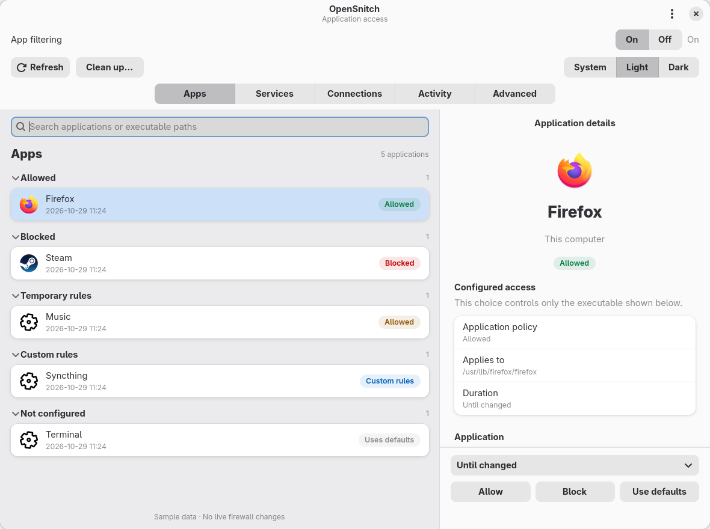
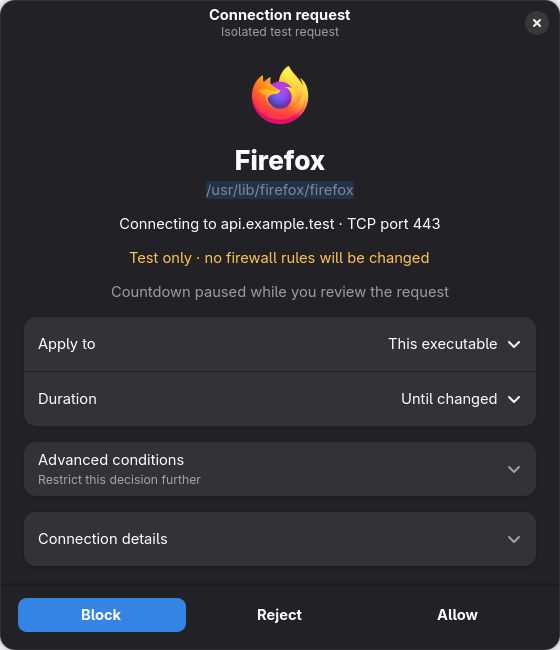

<p align="center">
  <small>Join the project community on our server!</small>
  <br/><br/>
  <a href="https://discord.gg/btZpkp45gQ" target="_blank" title="Join our community!">
    
  </a>
</p>
<hr/>

<p align="center">
  
  <p align="center">
    
    <a href="https://github.com/evilsocket/opensnitch/releases/latest"></a>
    <a href="https://github.com/evilsocket/opensnitch/blob/master/LICENSE.md"></a>
    <a href="https://goreportcard.com/report/github.com/evilsocket/opensnitch/daemon"></a>
    <a href="https://repology.org/project/opensnitch/versions"></a>
  </p>
</p>

<p align="center"><strong>OpenSnitch</strong> is a GNU/Linux application firewall.</p>

## GTK/libadwaita frontend — development fork

This fork is building an app-first OpenSnitch interface for Linux, with a native
GTK 4/libadwaita frontend. Development currently targets the **OpenSnitch 1.7.2
daemon** on the `gtk-ui-prototype` branch. The daemon, protocol, stored rules,
application inventory format and traffic-history schema remain unchanged.

The GTK frontend runs on KDE as well as GNOME; it does not require switching
desktops. This is a development checkout, not a finished GTK package release.
The original Qt frontend remains available for rollback and workflows that have
not migrated yet.

### Current interface

- **Apps:** persistent application inventory, readable names and artwork,
  searchable policy groups, executable details, and direct Allow / Block /
  Use defaults controls with duration choices.
- **Services:** system and current-user systemd discovery, including inactive
  services. Access controls apply to the verified executable; shared executables
  and ambiguous associations are disclosed. Services are never started or stopped.
- **Connections and Activity:** current sockets and recorded traffic, with
  search, filters, sorting, details and CSV export. Connection state is separate
  from configured access policy.
- **Connection prompts:** native application identity, destination details,
  scope and duration choices, optional conditions, and Block / Reject / Allow.
- **Advanced → Rules:** rule inspection and supported single/flat-AND editing,
  creation, duplication, enable/disable and deletion, with conflict checks.
- **Desktop integration:** light/dark/system appearance, bundled fallback icons,
  KDE StatusNotifierItem tray with Open, status, Pause/Resume and Quit, plus
  account-local login startup in the tray.
- **App filtering On/Off:** pauses or resumes application interception without
  stopping the daemon or deleting rules. System firewall policies are separate.
  Daemon 1.7.2 cannot report its pause state reliably, so reconnects show
  **Not confirmed** until a command is acknowledged.
- **Reviewed cleanup:** remove stale temporary-app entries and eligible matching
  rules, with a backup and acknowledgment checks; traffic history is retained.

### Screenshots

These captures render the actual GTK views with isolated **sample data**. They
do not expose a user's inventory or demonstrate live enforcement.





[Apps in dark mode](screenshots/gtk/apps-dark.png) ·
[Prompt in light mode](screenshots/gtk/prompt-light.png) ·
[Capture details](screenshots/gtk/README.md)

### Try the development frontend

Use a source checkout and system Python with PyGObject, GTK 4, libadwaita
**1.4 or newer**, gRPC/protobuf and the existing OpenSnitch Python runtime
dependencies. The installed daemon must already be running. Dependency packaging
and clean-install checks are still pending; this is not a standalone installer.

```sh
ui/bin/opensnitch-gtk-dev
```

The supervisor hands the local Unix socket from the source Qt frontend to GTK;
it does not restart the daemon. In development mode, closing GTK returns to Qt.
For an opt-in account default, application-menu integration and tray startup:

```sh
ui/bin/opensnitch-gtk-defaults
```

This installs user-level launcher/autostart overrides pointing to this checkout.
Keep the checkout in place. Default mode closes to the tray; **Quit** exits the
frontend, while **Return to Qt interface** explicitly rolls back. To restore the
previous account launchers and return the active session to Qt:

```sh
ui/bin/opensnitch-gtk-defaults --restore
ui/bin/opensnitch-gtk-dev --rollback
```

See the [GTK development guide](ui/opensnitch/gtkui/README.md) for compatibility
checks, isolated tests, ownership/conflict handling and rollback details.

### Scope and remaining work

Configured policy groups describe rules, not proof of internet reachability.
Existing user rules and priority conditions can affect a connection. Policy
requests remain pending until acknowledged; failures are shown explicitly.

Reliable, separately scoped **Wine/Proton program and prefix controls are planned,
not implemented**. A policy on a shared Wine runtime can affect multiple programs;
the current interface must not be treated as per-game isolation.

Qt retirement and packaged GTK installation are pending. System-firewall and
blocklist editors, node administration, full preferences, advanced diagnostics,
TLS endpoints, action hooks and complete rule-editor parity remain outside the
current GTK milestone. Keep Qt for unsupported workflows. The development
preflight rejects configured endpoints/hooks it cannot safely handle.

The upstream project information below is retained for reference. Its release
packages and full feature list describe upstream OpenSnitch, not GTK parity in
this branch.

## Upstream key features
 * Interactive outbound connections filtering.
 * [Block ads, trackers or malware domains](https://github.com/evilsocket/opensnitch/wiki/block-lists) system wide.
 * Ability to [configure system firewall](https://github.com/evilsocket/opensnitch/wiki/System-rules) from the GUI (nftables).
   - Configure input policy, allow inbound services, etc.
 * Manage [multiple nodes](https://github.com/evilsocket/opensnitch/wiki/Nodes) from a centralized GUI.
 * [SIEM integration](https://github.com/evilsocket/opensnitch/wiki/SIEM-integration)

## Download

Download deb/rpm packages for your system from https://github.com/evilsocket/opensnitch/releases

## Installation

#### deb
> $ sudo apt install ./opensnitch*.deb ./python3-opensnitch-ui*.deb

#### rpm
> $ sudo yum localinstall opensnitch-1*.rpm; sudo yum localinstall opensnitch-ui*.rpm 

Then run: `$ opensnitch-ui` or launch the GUI from the Applications menu.

Please, refer to [the documentation](https://github.com/evilsocket/opensnitch/wiki/Installation) for detailed information.

## OpenSnitch in action

Examples of OpenSnitch intercepting unexpected connections:

https://github.com/evilsocket/opensnitch/discussions/categories/show-and-tell

Have you seen a connection you didn't expect? [submit it!](https://github.com/evilsocket/opensnitch/discussions/new?category=show-and-tell)

## In the press

- 2017 [PenTest Magazine](https://twitter.com/pentestmag/status/857321886807605248)
- 11/2019 [It's Foss](https://itsfoss.com/opensnitch-firewall-linux/)
- 03/2020 [Linux Format #232](https://www.linux-magazine.com/Issues/2020/232/Firewalld-and-OpenSnitch)
- 08/2020 [Linux Magazine Polska #194](https://linux-magazine.pl/archiwum/wydanie/387)
- 08/2021 [Linux Format #280](https://github.com/evilsocket/opensnitch/discussions/631)
- 02/2022 [Linux User](https://www.linux-community.de/magazine/linuxuser/2022/03/)
- 06/2022 [Linux Magazine #259](https://www.linux-magazine.com/Issues/2022/259/OpenSnitch)

## Donations

If you find OpenSnitch useful and want to donate to the dedicated developers, you can do it from the **[Sponsor this project](https://github.com/sponsors/gustavo-iniguez-goya)** section on the right side of this repository.

You can see here who are the current maintainers of OpenSnitch:
https://github.com/evilsocket/opensnitch/commits/master

## Contributors

[See the list](https://github.com/evilsocket/opensnitch/graphs/contributors)

## Translating

<a href="https://hosted.weblate.org/engage/opensnitch/">

</a>
